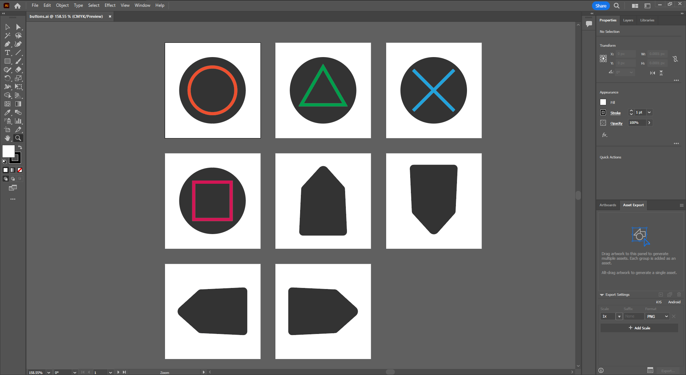
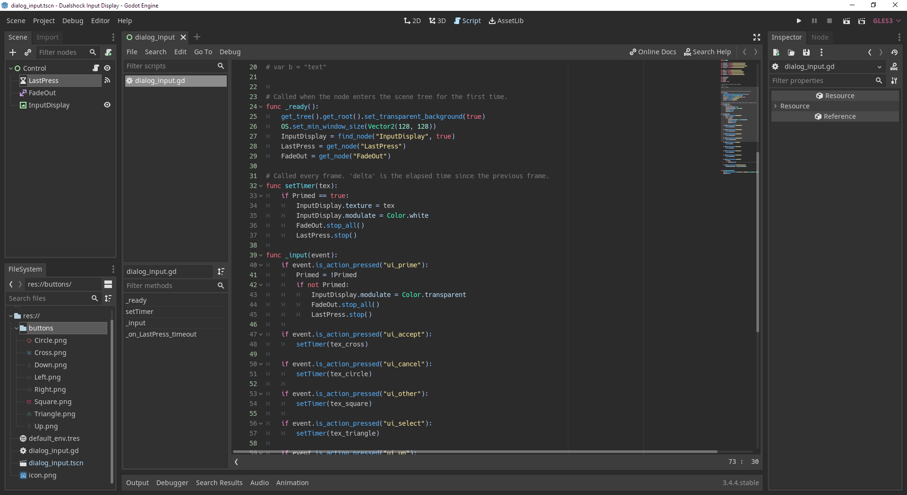

A few years ago I picked up a game titled ["Melody's Escape"](https://store.steampowered.com/app/270210/Melodys_Escape/), it was a fun little 2D side-scrolling rhythm game that generated tracks to play through procedurally allowing you to play any music you owned locally on your machine. By this point I'd already enjoyed [Audiosurf](https://store.steampowered.com/app/12900/AudioSurf/) and [Riff Racer](https://store.steampowered.com/app/351990/Riff_Racer__Race_Your_Music/), similar games that offer the same procedural idea, but Melody's Escape had a certain charm to it that kept me coming back. Visually it's stunning, and the steam workshop customisations granted a lot of freedom in how you wanted your 2D character to look. Beyond that though, it was just a simple low effort game that stole countless hours of my life. I was extroadinarily happy then, to discover that this year Icetesy had begun working on it's successor, simply named ["Melody's Escape 2"](https://store.steampowered.com/app/1829470/Melodys_Escape_2/).

Melody's Escape 2 is very much nothing but the successor to the original game, still in early access however it lacks the workshop customisability of the first, though we are assured this will be reintroduced before the official release. The game features a revised mapping algorithm to improve the overall playability of your music, but more importantly it breaks the 2-Dimensional barrier and introduces us to a much improved visual experience. In this sequel we see Melody from an Over-The-Shoulder perspective, giving us a good range of visibility as we traverse forward into our music amidst a sea of crashing waves that writhes along with the beat. The colours are stunning and the visual indications are surprisingly easy to read. The overall feel can change significantly depending on whether or not you're playing lo-fi chill beats to tap circles and dodge arches too, or literally flying rapidly through something far more up-tempo waiting for that invitable crash into a slow-motion launch back to earth. 

Despite it's early access status, the game feels complete already; it does what it says on the tin and the one-man developer of [Loïc Dansart](https://twitter.com/Epsicode) is quick to respond to feedback and bug reports which is a testament I believe to the passion behind the games development. 

Through my sessions playing the game I found myself recording footage of my playthroughs, not only to share with friends when I finally got that perfect-chain run through of my favourite songs but also to review so that I could find where I was making mistakes. The raw footage alone, however, just wasn't enough, I needed something more. Whilst I could often tell instinctively when and how I made a mistake it wasn't always obvious, and to clear it up I started work on an overlay to help me out. Thankfully I still had [Godot](https://godotengine.org/) installed from my last attempt at a game jam, and as I recently began life as an art student a discounted [Adobe Creative Cloud](https://www.adobe.com/uk/creativecloud.html?mv=search&mv=search&sdid=KH8NVGP5&ef_id=7e91dcb3fe131d17f147bf366c96dd10:G:s&s_kwcid=AL!3085!10!79508619076127!79508598937792) suite was at my disposal too.

I started by bashing out some icons in Illustrator, these were simple enough to do and it was a good introduction to the software for me, I was familiar with [Inkscape](https://inkscape.org/) already but the Illustrator workflow was significantly different, I was pleased with how quick the process ended up being. I exported the icons I was happy with as PNGs and loaded up Godot to begin working on the code. To start with I tried displaying all the icons at once with both a released and pressed state. This ended up being too visually stimulating and also at the same time offering very little readability. I scrapped that idea and worked towards a more minimal approach. The second attempt I placed the icon of the button most recently pressed in the top-center of the screen above both Melody and the track she runs along. This button would fade out after one second of being released to declutter the screen during moments of quietude. Godot offers a rather intuitive UI layout tool through it's control nodes where I could anchor the icon with margins to maintain it's position in a way that's responsive to screen size, just so if I did want to move it around I could resize my tool and drag it around with ease. 

Whilst the tool is less than 100 lines of code and only uses 4 of godot's nodes to achieve the finished result, the problem solving was a joy to approach and reminded me of why I first became interested in programming and game development in the first place. This was an excellent evening project and it's a tool I'll be using throughout my sessions of Melody's Escape 2 for countless hours to come. 

Today I am thankful that I'm able to combine my interests and produce fun tools to improve the world I live in. You can see the end result in the video below, a run through of [Broadcasts'](https://broadcast.bandcamp.com/) "America's Boy" from their 2005 album ["Tender Buttons"](https://broadcast.bandcamp.com/album/tender-buttons) in Melody's Escape 2. Thank you so much for reading and I hope you find ways to apply creative solutions to your problems as well.  

<iframe style="min-width:640px;min-height:360px;align-self: center;" src="https://www.youtube.com/embed/V29GMcyxA0k" title="YouTube video player" frameborder="0" allow="accelerometer; autoplay; clipboard-write; encrypted-media; gyroscope; picture-in-picture" allowfullscreen></iframe>

P.S. If it wasn't clear from the content in this post, I fully recommend checking out Melody's Escape 2 for yourself with nothing but my most heartfelt endorsement.