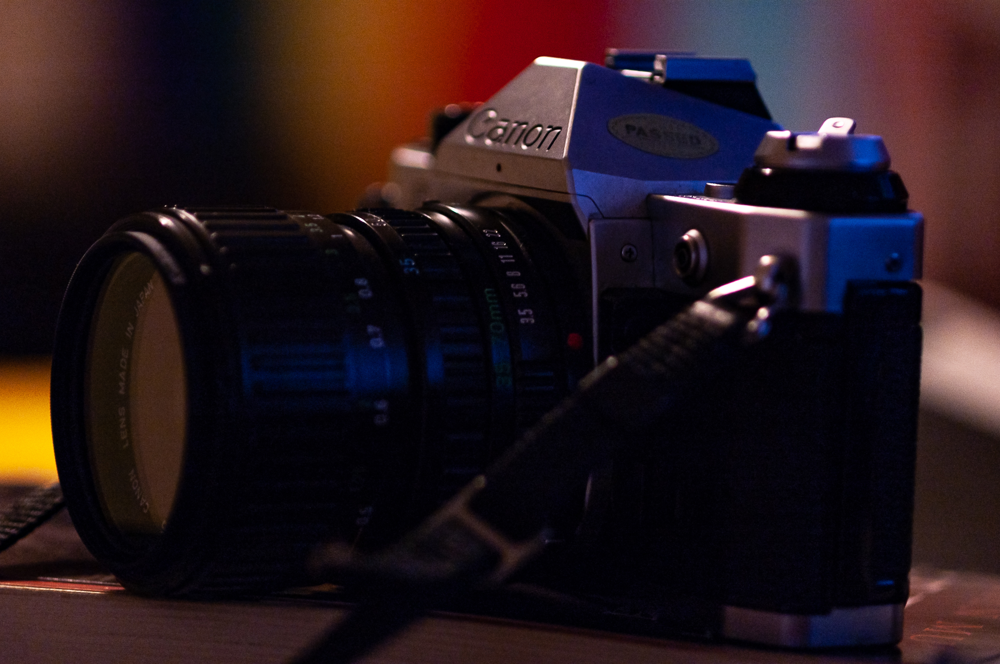
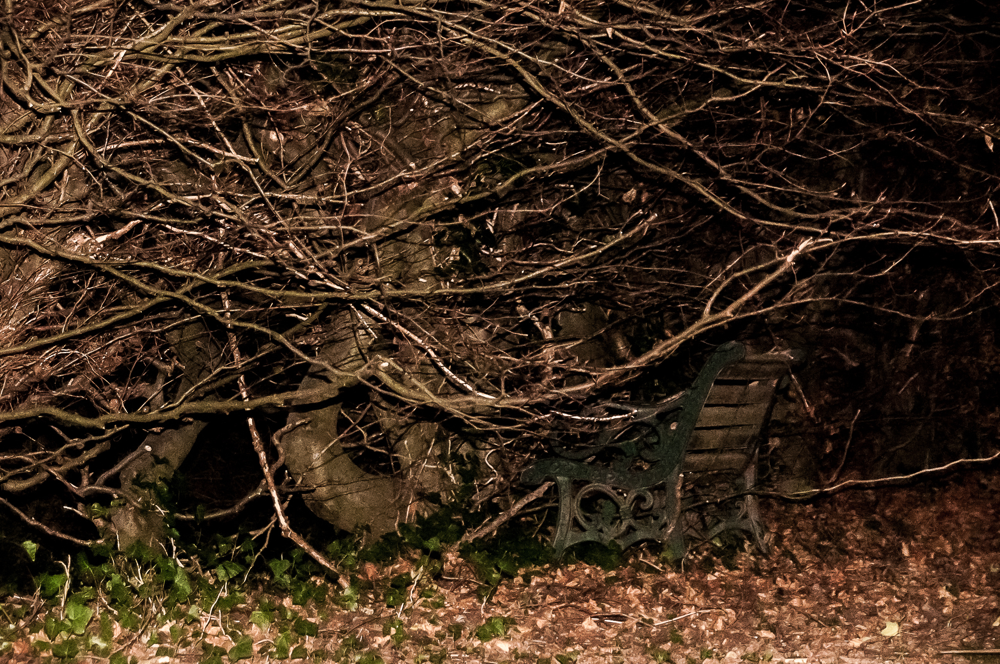
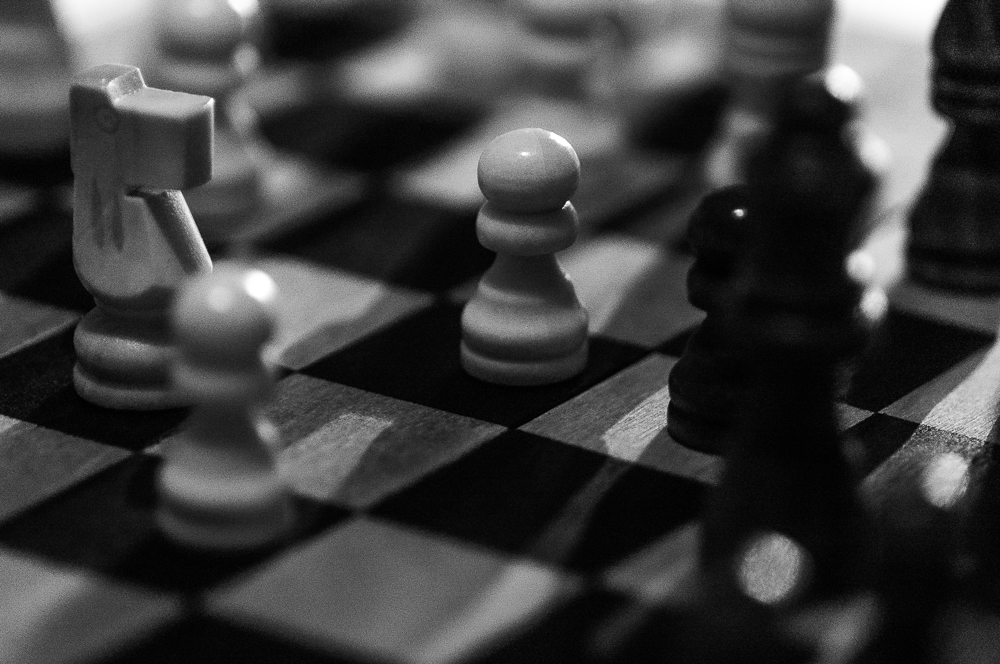
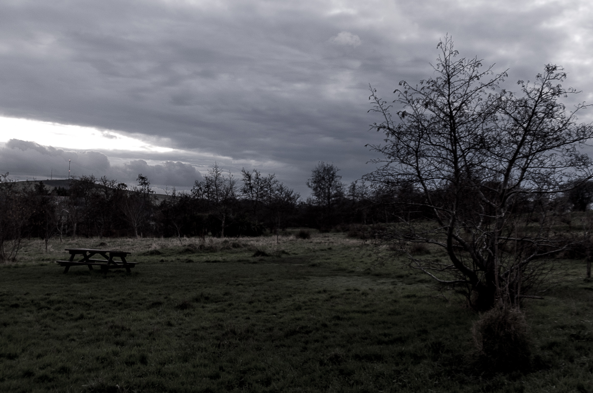

**Camera**: Nikon D50  
**Lens**: Nikkor AF Micro 105mm 1:2.8 D  
**Filter**: None  
**Editing Suite**: Adobe Lightroom Classic

As part of my return to college to pursue an art degree over the next four years I've begun to explore photography again. So I dug out my old D50, borrowed some lenses from the photography department, and began documenting and capturing moments in time that resonate with me. Specifically on the course I've been introduced to 35mm film photography, and all the processes of developing and printing that comes with it. The camera photographed above is my tutors old AE-1 Program 35mm film camera, and it has been so good to me in the past few months.

Unarguably a classic, the AE-1 Program is a manual focus only camera and through using it I've come to respect the relationship between Apeture, Shutter Speed and ISO better than I feel I ever could have done with an automatic counterpart. Shooting with the D50 through it's AF lenses, however, has taught me to appreciate the automatic processes as well. Already in the first unit of work I've completed I was able to print a reasonable photo from film, and I am hoping to achieve a significant collection of prints throughout my second unit currently underway. I have a strong desire to learn about methods of printing as well as the application of more experimental processes. 

Of the photographers I've researched as part of my education I've taken a particular shine to the work of [Patti Smith](https://www.pattismith.net/intro.html), [Irving Penn](https://irvingpenn.org/) and [Ernst Haas](https://ernst-haas.com/biography/), each for their unique and stylistic approaches to capturing ideas throughout their collective works. Haas especially piques my interest through his use of angle in composition and the vibrant contrast of shape and colour to emphasise a mood or feeling.

All in, I'm glad to be studying this subject in an environment where I'm given the opportunity to freely express myself in my work and with a tutor who is not only extremely experienced, but always eager to share an anecdote or two about his life and his work. You can look forward to seeing more of my photography on this blog as I develop the practice through the next few years.

Meanwhile, below are a few of the digital shots I've taken with the D50, thanks for reading.

