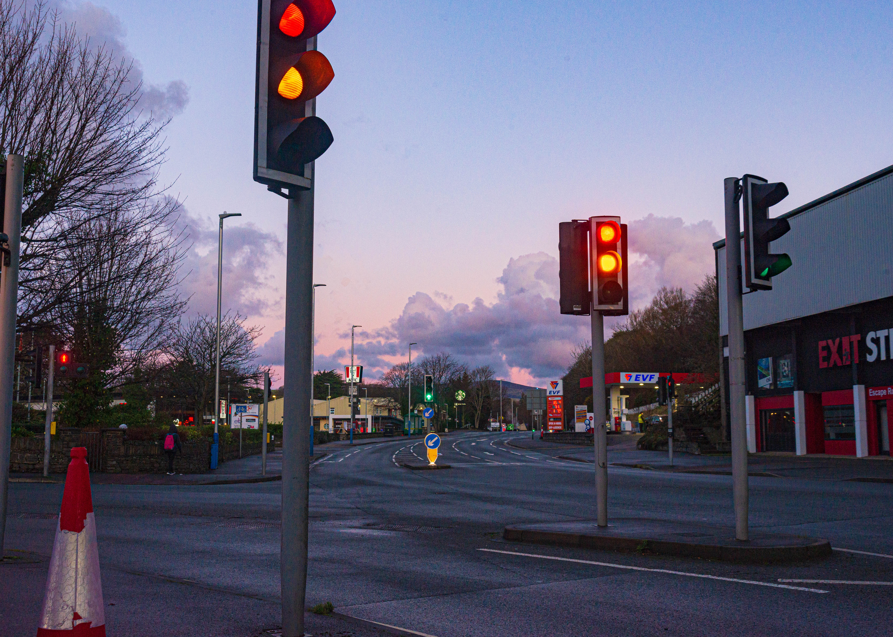
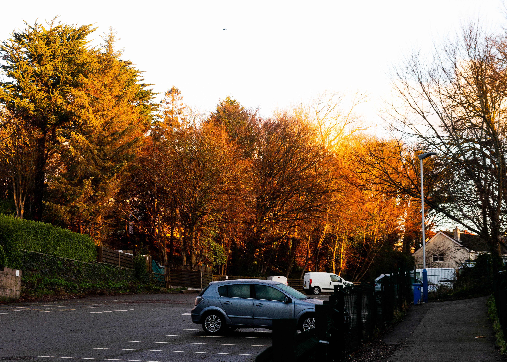
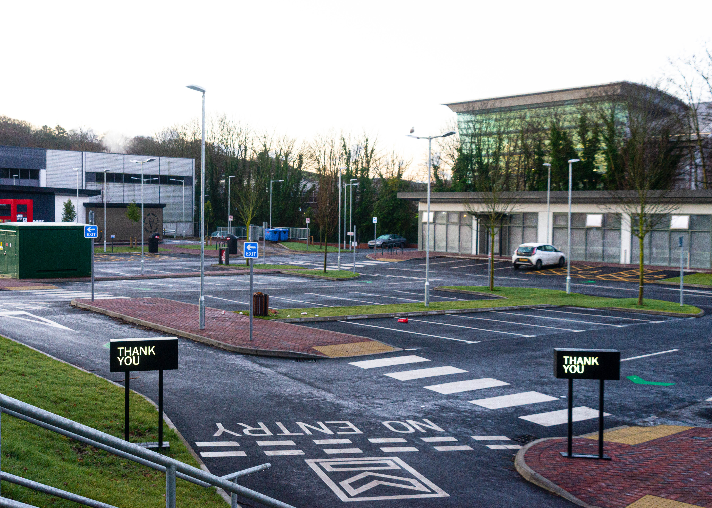
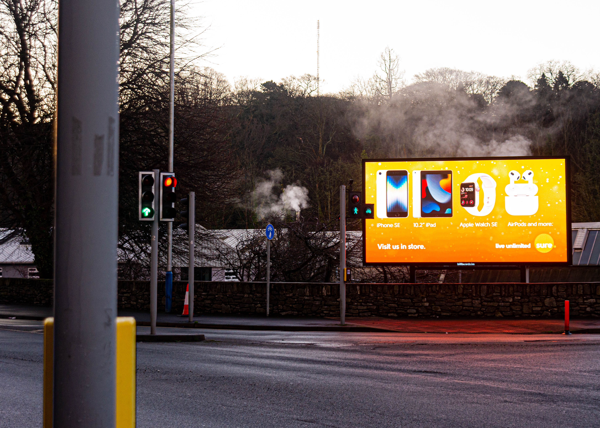

**Camera**: Nikon D610  
**Lens**: Nikkor AF 24-120 1:3.5-5.6 D  
**Filter**: None  
**Editing Suite**: Adobe Lightroom Classic

First of all, let wish you a truly happy new year, if you're reading this, you've made it through another one. 2022 was turbulent and full of challenge but now it's at an end, which brings us to today. My holiday season was not as productive as I'd have liked it to be, I met with friends and family and winter flu in the final weeks and so I was unable to pursue as many endeavours as I had hoped. That being said, I won't let it slow me down going into the second half of my foundation year at college. Education has been treating me well and I'm still thoroughly excited about the opportunities that lie ahead; with unit 2 coming to a close in the next couple of months I'll need to start giving some serious thought to my final major project for unit 3 and the creative control I'll have over it's direction is both liberating and terrifying. 

With that in mind, the one subject that's stuck with me hard through the past few months has been photography, and so over the holiday period I treated myself to a bit of an upgrade from my D50 to a D610, grabbed a nifty fifty lens and also a couple of filters to go with it. This year I've made my resolution relevant and measurable to my developing skill in this area. Simply put, I want to take at least one photo I'm happy with each week, if I take more that's a bonus but some weeks are going to be easier and others more difficult. I started this off immediately and spent the first few mornings of the new year waking up before the sunrise to get some early morning street shots of my nearby area, the weather hasn't been great but the dampness has really helped the impact of the warmer lights on the environment and I can confidently say I have been able to achieve my goal this week. 

As I return to regular classes starting next week I'll begin a few more guided projects across multiple areas, continue to build up my portfolio and experience what I expect will be a tremendous trip to several galleries in London at the start of February. The trip being part of the incentive to upgrade my equipment as the streets of London offer a different variety of opportunity than I'd find on the quiet island of which I live. 

2023 promises to be even more exciting than 2022, and though I made one of my biggest decisions in life last year I've no doubt I'll find a way to make even more. Throughout this all I am thankful I have friends who are so supportive of my choice and direction, who genuinely appreciate the art I am producing and who won't hesitate to encourage me to continue, I couldnt' be more appreciative of them if I tried. So here's to new challenges, new directions, and new opportunities. Have a wonderful new year, and check out some more of my shots from the first week of January Below.

